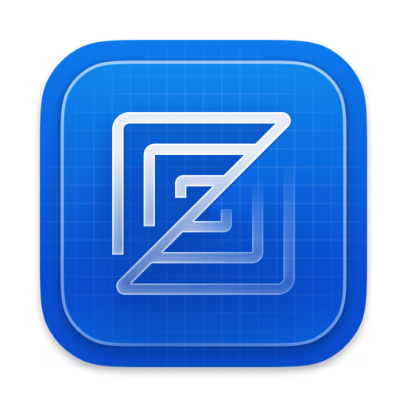

<p align="center">English | <a href="README.zh-CN.md">中文</a></p>

<div align="center">
  
  <h1>Zite</h1>
  <p>The ultra-fast, clean, and lightweight native code editor.</p>
  <p>Built on Zed's core architecture · Zero AI bloat · Pure editing experience</p>
</div>

---

**Zite** (formerly Zed Lite) is a high-performance native code editor written in Rust, focusing purely on speed, minimal memory footprint, and an uncompromised text editing experience. All bundled AI agents, speech dictation models, and heavy neural runtime dependencies have been completely stripped out, returning the editor to its core mission: blazing-fast, distraction-free code editing.

## 🌟 Key Custom Features

- **Ultra-Lightweight (52k LOC stripped)**: Completely purged AI agents, voice dictation, and heavy runtimes. Link times improved by 40% - 60%, app size down by 30 - 50 MB, and heavy-workload memory reduced by over 50%.
- **Project Search Tree View**: Toggle search hits into a foldable directory tree with branch counts for clean multi-file navigation in large repos.
- **Customizable Activity Bar**: Place the activity bar horizontally on top to save screen width, or dock it vertically on the left/right:
  ```json
  "activity_bar": { "position": "top" } // Options: "top" | "left" | "right"
  ```

---

## ⚡ Upstream Tracking & Coexistence

- **Absorbed Upstream Enhancements**: Selectively tracks official non-AI improvements, including file tree sorting by extension, Markdown preview toggle to source, and quit crash fixes.
- **Isolated Coexistence & Update Shield**: Standalone identity (`Zite.app`) runs alongside official Zed without conflict; disabled background auto-updates to prevent custom builds from being overwritten.

---

## Building & Installation

### Requirements
- macOS 12.3+ (Apple Silicon / Intel)
- Rust stable toolchain

### Build and Install into /Applications
```sh
./script/bundle-mac -i
```

---

## Licensing & Acknowledgements

- Licensed under GPL-3.0-or-later and Apache-2.0.
- Built upon [Zed](https://github.com/zed-industries/zed) and GPUI.
