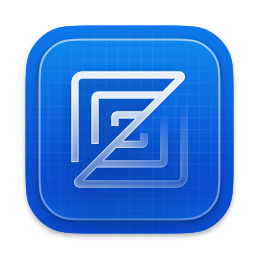

<p align="center"><a href="README.md">English</a> | 中文</p>

<div align="center">
  
  <h1>Zite</h1>
  <p>极速、纯粹、极致轻量的原生代码编辑器。</p>
  <p>基于 Zed 核心架构打造 · 剔除 AI 冗余 · 纯粹文本编辑</p>
</div>

---

**Zite**（原 Zed Lite）是一款专注于极致性能与原生体验的 Rust 代码编辑器。我们移除了庞大繁杂的内置 AI 智能体与重型依赖，让编辑器回归毫秒级响应、超低内存占用与纯粹的代码编写体验。同时针对大型工程日常开发痛点，深度魔改增强了全局搜索与文件管理能力。

## 🌟 核心魔改亮点

- **极致精简（减重 5.2 万行代码）**：彻底剥离 AI 智能体、语音模型与重型依赖，构建链接提速 40% 至 60%，体积瘦身 30 至 50 MB，高负载场景物理内存降低 50% 以上。
- **全局搜索树状视图 (Tree View)**：搜索面板支持一键切换分层目录树，支持文件夹折叠与分支命中计数，大项目检索一目了然。
- **活动栏自由布局 (Activity Bar Layout)**：支持置顶横排（完全省出侧边栏宽度）或左右竖排，按需最大化代码可视面积：
  ```json
  "activity_bar": { "position": "top" } // 可选: "top" (顶置横排) | "left" | "right"
  ```

---

## ⚡ 官方特性跟进与独立共存

- **吸收官方新特性**：持续同步官方优质非 AI 改进，包含文件树按后缀归类排序、Markdown 预览切回源码及 macOS 退出崩溃修复。
- **独立共存与防覆写**：采用专属应用标识（`Zite.app`）与官方版并行共存无冲突；彻底禁用后台静默升级，保障定制版不被冲掉。

---

## 本地构建与安装

### 系统要求
- macOS 12.3+ (Apple Silicon / Intel)
- Rust 稳定版工具链

### 构建并安装至系统 Applications
```sh
# 增量编译并安装到 /Applications/Zite.app
./script/bundle-mac -i
```

---

## 许可证与致谢

- 遵循 GPL-3.0-or-later 与 Apache-2.0 开源许可证。
- 感谢 [Zed](https://github.com/zed-industries/zed) 团队优秀的开源底层与 GPUI 渲染引擎。
